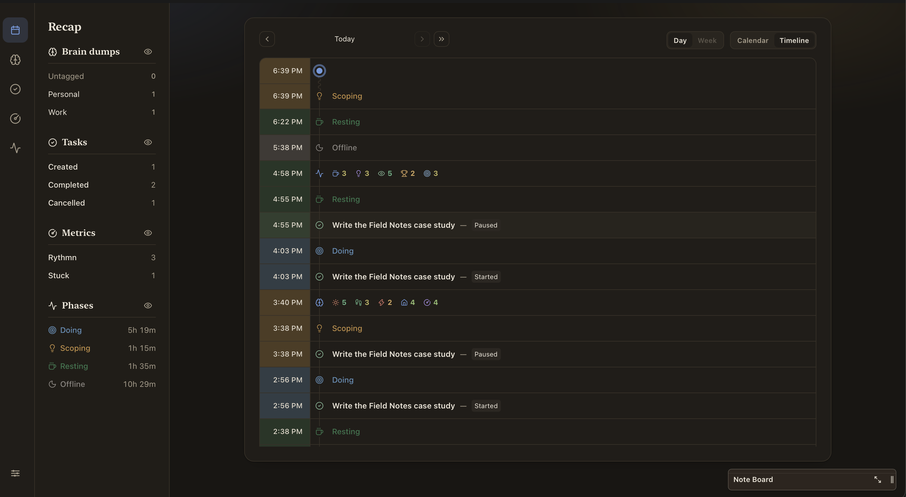
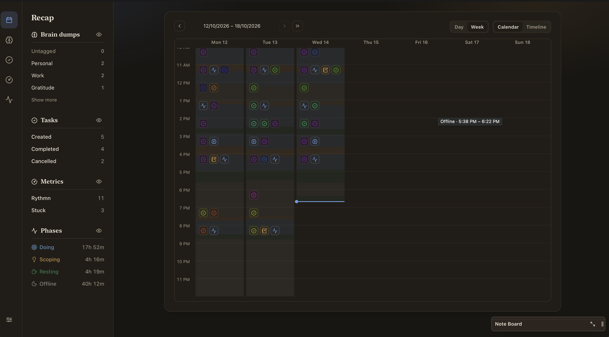
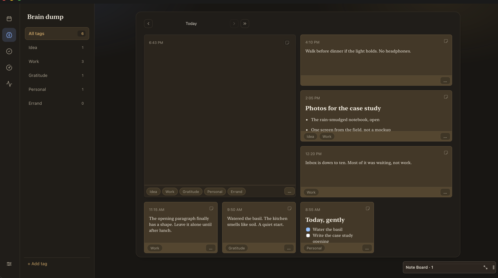
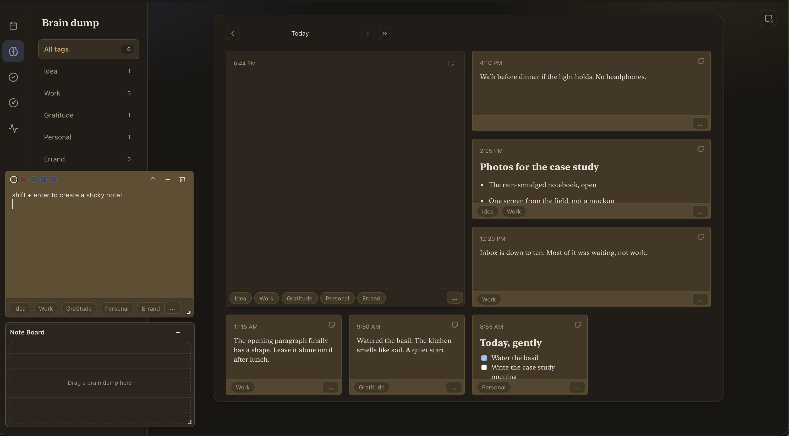
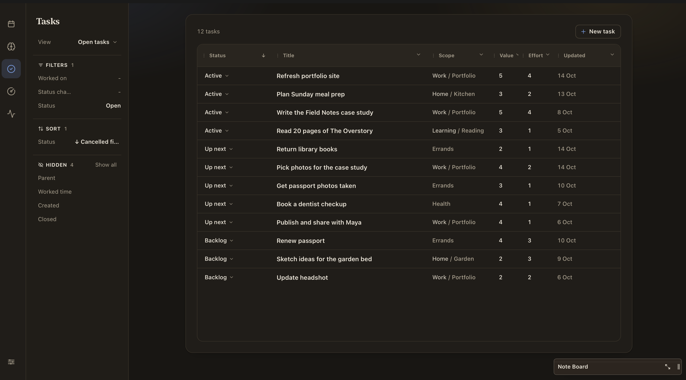
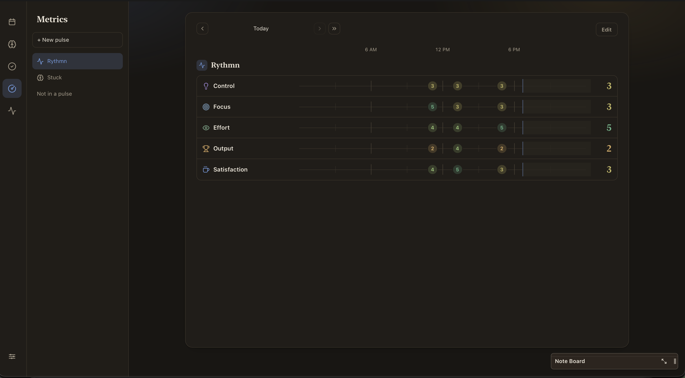
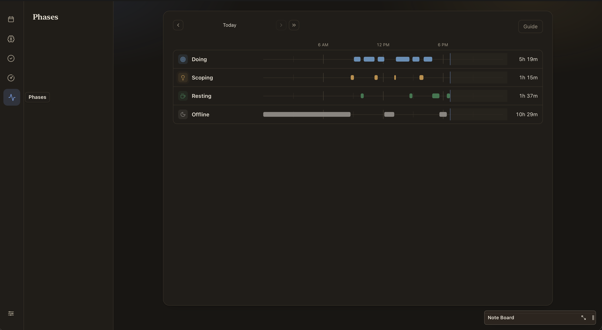

# Try Nest

A private desktop app for macOS to manage my cognitive workload. It tracks my tasks, brain dumps, and metrics. Everything is stored locally with SQLite.

## Legend

| Where | Jump to |
| --- | --- |
| [Demo](#try-the-demo) | Seeded local run |
| [Popup](#popup) | [Timer](#1-timer) · [Brain dump](#2-brain-dump) · [Metrics](#3-metrics-check-in) · [Tasks](#4-tasks) |
| [Dashboard](#dashboard) | [Recap](#recap) · [Brain dump](#brain-dump) · [Tasks](#tasks) · [Metrics](#metrics) · [Phases](#phases) |

## Try the demo

Try it for yourself and share your thoughts!

```sh
npm install
npm run demo
```

This runs Nest with seeded data so you can immediately get a feel for how I use it.

The demo starts Tasks with an editable “Open tasks” saved view: open statuses,
Status sorted descending, and Status, Title, Scope, Value, Effort, and Updated
columns. The view is seeded once; subsequent view edits persist in demo storage.

## Popup

Once the demo is running, press **⌘⇧E** to open the Nest Popup.


The Popup has four features:

### 1. Timer

Click to select a duration that will run in the background. I use it to keep track of my Pomodoro sessions and rest sessions.

### 2. Brain dump

I struggle with cognitive overload and always needed to open a notes app like Apple Notes or Notion just to write down my thoughts.

Type whatever you want, then press **Shift + Enter** to save it.

### 3. Metrics check-in

I check in on my cognitive state across a few factors and domains. This helps me:

- Make routine reviews more productive.
- Catch myself in a spiral and zoom out by asking myself these questions.

There are two sets of metrics I track:

- **Rhythm:** A routine set I try to track as much as possible, every hour or whenever I remember.
- **Stuck:** A set I track when I find myself really struggling. Asking myself where I am on each metric reminds me to take a step back and reprioritise.

### 4. Tasks

A task manager I built for myself. From the Popup, you can:

- Press **Play** (the left button) to start working on a Task. This automatically runs a stopwatch that measures how much time you spend on it.
- Double-click any Task to create a Subtask from it.
- Add new Tasks using the **+** button on the right of the status row.
- Mark Tasks as completed using the **tick** button, or deprioritise them using the **double down arrow**.

## Dashboard

Open the dashboard by clicking the **square** in the top-right corner of the Popup.

### Recap

The Recap Section helps me review my days. The Insights on the sidebar are a condensed summary of my usage.



Timeline view shows timestamped events in rows.



Calendar view uses an hourly grid.

### Brain dump



View brain dumps across each day and tag them for easier filtering.

You can also press **Shift + Enter** to create a sticky note on the dashboard so you can write multiple notes at once.



Drag a sticky note onto the Note Board to stash it.

### Tasks



A table view of all the Tasks you have created. Play around with the display controls (filter, sort, and hidden columns), then save a new view by clicking the **View** row and **Save current as view**.

### Metrics



View the Metrics you have recorded across different days. Try creating your own Metrics!

### Phases



A mini activity monitor that identifies how you spend your time:

- **Doing:** A Task is actively running with the stopwatch.
- **Scoping:** You are focused on Nest without a Task running, or on Notion.
- **Resting:** Time outside Doing or Scoping.
- **Offline:** Away from the keyboard.
