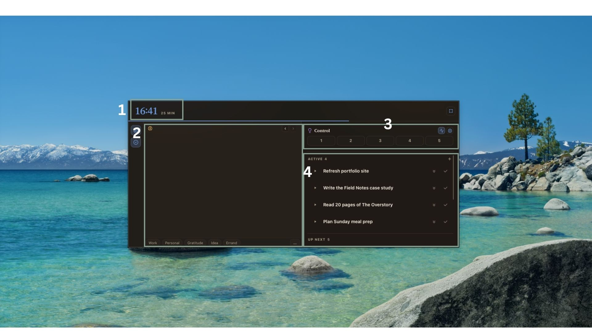

# Try Nest

A private desktop app to manage my cognitive workload. It tracks my tasks, my brain dumps, and some metrics. Everything is persisted locally with sqlite. (only for macOS)

Try it for yourself and share your thoughts!

```sh
npm install
npm run demo
```

This runs Nest with some seeded data so u can immediately get a feel of how i use it.

The demo starts Tasks with an editable “Open tasks” saved view: open statuses,
Status sorted descending, and Status, Title, Scope, Value, Effort, and Updated
columns. The view is seeded once; subsequent view edits persist in demo storage.

## Popup
Once the demo is running, do  ⌘⇧E to open up the Nest Popup.



There are 4 functionatlies in the popup.
1. A timer 
Click & select a timing that will run in the background. I use it to keep track of my pomodoro sessions and rest sessions

2. Brain Dump text editor 
I struggle with cognitive overload and always needed to open up a notes app like apple notes or notion to just write down my thoughts. 

Type whatever u want, then shift + enter to save it

3. Metrics Check-in
I check in on my cognitive state across a few factors/domains. It serves the following

- routine reviews are much more productive
- asking myself the question helps me catch myself in a spiral and zoom out

There are 2 sets of metrics i track
- Rhythmn is a routine one i try to track as much as possible (every hour or whenever i remember)
- Stuck: i track when i find myself really struggling. asking myself where i am on each metric reminds me to take a step back and reprioritise

4. Tasks
A task manager i built for myself. From the popup, u can 
- press play (left button) to start working on a task, which automatically runs a stopwatch that measures how much time u are spending on each task
- double click any task to create a subtask from it
- add new tasks (+ button on the right of the status row)
- mark them as completed (tick button) or deprioritise them (double arrow down)

## Open the dashboard
Open up the dashborad by clicking the square on the top right corner of the popup.

## Recap section
<image>

The recap section gives u an overview of how you are spending your time. Timeline view shows u timestamped events every row, and calendar view fixes an hourly grid. 

## Brain dump section
<image>
View brain dumps across each day. Tag them so u can filter better
You can also shift + enter to create a sticky note on the dashboard so u can write multiple notes at once

## Tasks section
<image>
A table view of all the tasks you have created. Play around with the display controls (filter, sort, hidden) and saving it as a new view by clicking the View row and "save current as view"

## Metrics section
<Image>
View the metrics you have clocked across the different days. Try creating your own metrics!

## Phase
<Image>
A mini activity monitor that identifies how you are spending your time
- Doing: when a task is actively running (with the stopwatch)
- Scoping: When you are focused on Nest (without any tasks running) or Notion
- Resting: Neither Doing nor scoping 
- Offline: AFK
